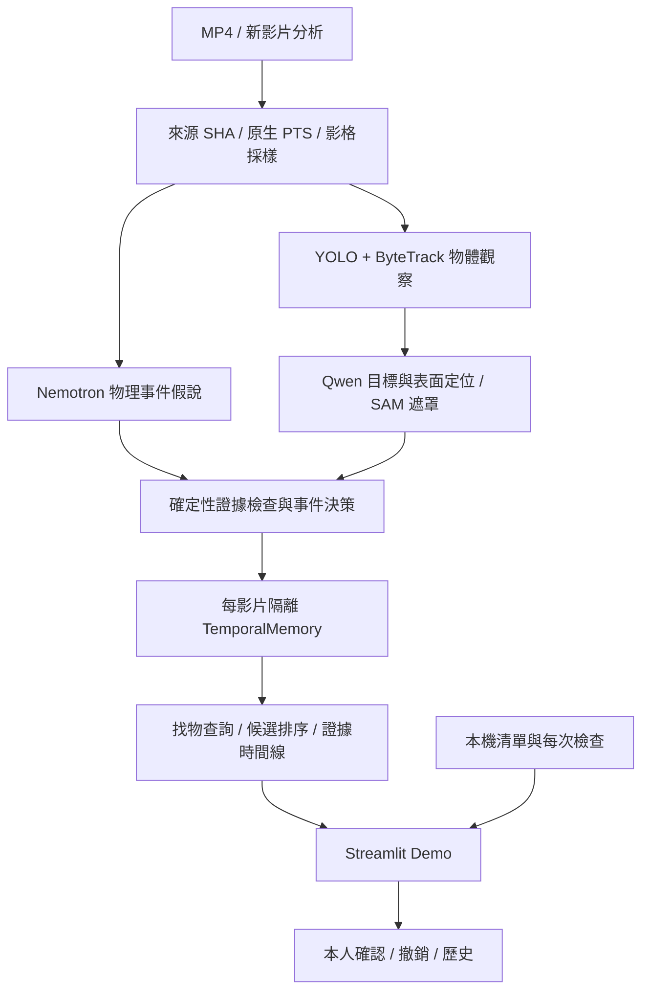

# FindMind

用影片建立可查詢的物體空間記憶，並提供找物與出門清單的互動展示。

**目前版本：Phase 9 競賽 Demo（2026-10-21）**。已串接新影片分析、歷史候選位置查詢、影格證據、出門提醒與本人手動確認。這是研究原型；目前實跑沒有 VERIFIED 位置，歷史候選不代表物品現在的位置，也不代表使用者已隨身攜帶。

## 先看這裡

| 需求 | 入口 |
| --- | --- |
| 最新進度、驗證結果與限制 | [最新報告](WORKSPACE/VLMtest/LATEST_REPORT.md) |
| 展示操作步驟 | [Phase 9 Demo Guide](artifacts/phase9/DEMO_GUIDE.md) |
| 版本保存範圍 | [Version Status](WORKSPACE/VLMtest/VERSION_STATUS.md) |
| 新影片 CLI 與保存後查詢 | [Phase 7 使用說明](artifacts/phase7/README.md) |
| 標註、實驗與歷史資料導覽 | [WORKSPACE](WORKSPACE/README.md) |
| 離線 GT 標註工具 | [工具 README](tools/findmind-gt-annotator/README.md) |

## 已完成的功能

- **新影片入口**：上傳 MP4，背景執行 CV、事件推論、目標／表面定位，建立獨立的記憶 session。
- **找物 Agent**：中英文類別查詢、歷史候選排序、原生影片時間、框／遮罩、來源影格與不確定性。
- **空間記憶**：物體觀察、表面區域與關係候選保存在既有 TemporalMemory；證據不足時回 UNKNOWN。
- **出門提醒**：手機／鑰匙／錢包等清單可編輯，每次檢查獨立保存，支援明確確認、撤銷、新檢查與歷史紀錄。
- **找物交接**：清單中的「尋找」帶入同一份記憶，返回後保留當次檢查狀態。
- **來源與執行追溯**：影片及 Graph hashes、native PTS、frame mapping、模型原文、階段結果與失敗紀錄。

出門清單的「已帶妥」只代表本人操作。影像有候選位置與本人已確認攜帶是兩個獨立狀態；展示模式的確認也會另行標記。

## 架構



VLM 產生物理事件假說；軟體負責來源、證據、時間與記憶整合。追蹤 ID、類別或定位結果不會自行變成已授權的持久身分。

## 啟動互動 Demo

### 已具備本機環境的電腦

在專案根目錄的 PowerShell 執行，保持視窗開啟：

```powershell
powershell.exe -NoProfile -ExecutionPolicy Bypass -File scripts\start_findmind_demo.ps1
```

開啟 **http://127.0.0.1:8514/**。可指定 `-Port 8514 -MaxUploadMB 200`；預設只監聽本機。

1. 選「錄製結果 Demo」及已有的影片記憶。
2. 首頁選「我要出門了」，需要時按「開始新檢查」。
3. 點手機的「尋找」，查看歷史候選與來源影格。
4. 返回出門檢查，由本人按「我已帶妥」；可撤銷。
5. 展示下一輪時開新檢查，不沿用上一輪確認。

錄製模式只查已保存的記憶，不載入 GPU 模型。新影片模式必須上傳 MP4 並明確勾選 GPU 分析；背景工作狀態保存於磁碟，可在頁面重新整理後查看。

### 給其他人的環境說明

**GitHub 版本包含程式、測試、報告與展示截圖，不包含完整執行環境、模型、原影片或已處理 session。只 clone 不會直接出現錄製結果。**

- 啟動腳本使用 `.venv\Scripts\python.exe`、`src` 及本機 `artifacts/pass_i/runtime/vendor` 中的 Streamlit；其他電腦須先備妥相容環境。
- `pyproject.toml` 保留原專案的 Python 3.12 依賴宣告，目前實驗另使用本機既有 runtime；它不是完整 Demo／WSL 環境的自動安裝器。
- 要查錄製結果，須另外取得完整、來源一致的 `artifacts/findmind_sessions/<session_id>/`，包含 Graph、manifest、receipt 與證據影格。不要單獨替換其中的檔案或 hash。
- 新影片推論需要既有 Windows GPU 環境與 Ubuntu WSL Nemotron runtime；目前沒有一鍵跨電腦部署或自動下載模型。

| 新影片元件 | 目前使用的本機資產 |
| --- | --- |
| CV | `.models/yolo11s.pt`、Ultralytics／ByteTrack |
| 定位 | `.models/Qwen2.5-VL-7B-Instruct`，NF4 runtime |
| 遮罩 | `.models/sam2.1_hiera_small.pt`、官方 SAM2 本機依賴 |
| 事件推論 | `.models/Nemotron-Nano-12B-v2-VL-NVFP4-QAD`、WSL `.runtime/nemotron/` |

各模型分階段載入。首次 fresh-video 整合實跑：36.77 秒影片約需 723 秒；這是單一已知影片的整合測試，不是效能保證或未見資料泛化結果。

## 命令列

```powershell
# 會執行既有 GPU 模型；需要上述本機資產
.venv\Scripts\python.exe -X utf8 -B scripts/run_findmind_video.py --video "C:\Videos\new_video.mp4" --query "Where is my phone?"

# 只查已保存的 session，不跑模型
.venv\Scripts\python.exe -X utf8 -B scripts/run_findmind_video.py --session "artifacts/findmind_sessions/<session_id>" --query "Where is my phone?"
```

輸出保存在獨立 session；原始影片不會被複製進去。處理失敗時保留階段輸出與日誌，未提供自動重試／續跑。背景工作鎖失聯時，先確認 Windows 與 WSL 模型程序確實停止，再由操作者處理；不要盲目解除 GPU 鎖。

## 資料夾

```text
apps/findmind_demo.py          Streamlit 應用入口
src/findmind_demo/            找物 Agent、session、證據、工作與出門清單
src/memory_graph/integration/ 事件／CV adapter、空間整合、新影片流程
scripts/                     Demo、CLI 與各階段執行入口
tests/                       契約與功能測試
WORKSPACE/VLMtest/            固定名稱的最新報告與目前決策
WORKSPACE/Pass_I/             身分標註與實驗導覽
WORKSPACE/Pass_T/             時間事件標註與契約導覽
artifacts/phase5–phase9/      各階段報告（部分大型證據僅在本機）
tools/findmind-gt-annotator/   已有的離線人工 GT 工具
```

下列是執行時建立、這次不提交的資料：

```text
artifacts/findmind_sessions/  原始模型輸出、Graph 與證據影格
artifacts/findmind_uploads/   上傳影片及來源記錄
artifacts/findmind_jobs/      背景工作、PID、日誌與 GPU 鎖
artifacts/findmind_demo/      個人清單、手動確認與歷史檢查
.models/ .runtime/ .venv/     模型、執行環境與暫存
```

歷史報告中的本機證據連結可能不在 GitHub 上；保留它們供原環境追溯，不表示 clone 包含全部資料。既有 Git 歷史中的檔案未做刪除或清理。

## 驗證與限制

Phase 9 完成時 **101 個 focused tests 通過**：15 出門清單、15 Demo、71 Phase 4–7 回歸。另已驗證完整瀏覽器流程與服務重啟後狀態保存。測試原文見 [Phase 9 報告](artifacts/phase9/PHASE9_REPORT.md)。

在原本已配置的本機環境可執行：

```powershell
New-Item -ItemType Directory -Force .runtime\findmind_demo\temp | Out-Null
$env:TEMP = (Resolve-Path .runtime\findmind_demo\temp).Path
$env:TMP = $env:TEMP
.venv\Scripts\python.exe -X utf8 -B -m unittest discover -s tests -p test_findmind_departure.py
.venv\Scripts\python.exe -X utf8 -B -m unittest discover -s tests -p test_findmind_demo.py
.venv\Scripts\python.exe -X utf8 -B -m unittest discover -s tests -p "test_phase*_*.py"
```

部分整合測試依賴未上傳的真實 session／本機資產；不是乾淨 clone 的通用 CI 命令。

目前仍需改善：

- 持久身分與物理接觸／表面關聯仍不可靠，現有結果均未達 VERIFIED 位置。
- keys／wallet 可查詢與加入清單，但尚未驗證其實際影片感知能力。
- 沒有自動出門偵測、忘帶偵測或獨立持有確認。
- 事件生成可能 strict-invalid；原文保留，不轉成 NO_EVENT 或強行更新可信記憶。
- 沒有完整 production／Shadow mode 驗收，也不宣稱正式整體準確率或 precision／recall／F1。

## 階段報告

[Phase 5 空間記憶](artifacts/phase5/PHASE5_SPATIAL_MEMORY_REPORT.md) · [Phase 6 目標與表面感知](artifacts/phase6/PHASE6_REPORT.md) · [Phase 7 新影片流程](artifacts/phase7/PHASE7_REPORT.md) · [Phase 8 找物 Demo](artifacts/phase8/PHASE8_REPORT.md) · [Phase 9 出門提醒](artifacts/phase9/PHASE9_REPORT.md)
