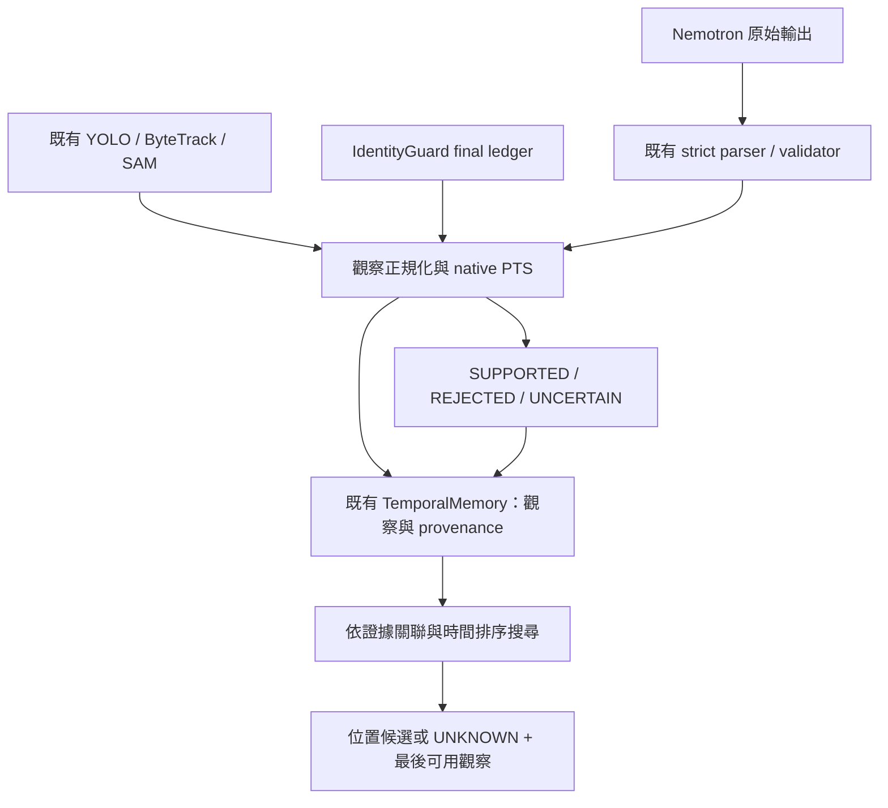

# Phase 4：Nemotron → Memory Graph → 物件搜尋整合

更新：2026-10-20。**已完成可執行的 CPU recorded-output 端到端整合與真實資料示範。** 目前不是新影片的全自動感知服務，也沒有證明模型整體正確率。

## 實際執行結果

使用 test1–test9 原片身分與 native PTS，重用全部 **184 份既有 Nemotron 回應**，沒有重新推論。讀取既有 YOLO／ByteTrack、SAM 紀錄與 IdentityGuard `runs_final` 最終 ledger。

| 項目 | 結果 |
|---|---:|
| Nemotron 回應 | 184 |
| 原始 strict-valid 回應 | 108 |
| 可正規化 VLM state claims | 1,523 |
| CV 觀察 | 8,163 |
| 其中 YOLO／ByteTrack | 7,702 |
| 其中 SAM propagation | 461 |
| 通過 exact observation／capability／revocation 核對的 CV 身分關聯 | 110 |
| 可正規化事件假說 | 143 |
| SUPPORTED | 0 |
| REJECTED | 53 |
| UNCERTAIN | 90 |
| 確認的 physical transitions／具名位置 | 0／0 |
| 手機搜尋 | 九片均 UNKNOWN |

53 筆拒絕包含 **48 筆模型自身前後 state 與事件矛盾、5 筆來源引用時間不合法**。這是拒絕該筆假說／證據，並非證明影片沒有事件。90 筆不確定皆缺實例關聯及獨立物理 state 證據，其中 32 筆另有 raw strict-invalid 問題。

20 份回應無可使用的 schema 結構，保留完整 raw response 與診斷，沒有轉成 NO_EVENT。這次採用既有 strict schema／明確外層 fence 分離政策，沒有把歷史描述性提取的全部 146 筆候選強行變成 143 筆合法事件；不滿足可正規化結構的內容留在 response receipt。外層 fence 的可讀內容仍保持 raw strict-invalid。

## 已實作的連線



- **Nemotron adapter**：保留 window ID、alias→source frame／PTS、object description、state claims、before／after 引用、raw 原文與 hash、各層 validation。原始 CRLF 不會被正規化改寫。
- **CV adapter**：保留 detector bbox、信心值、track candidate、SAM 診斷。原先以 FPS 換算的 timestamp 留在 provenance；canonical time 取原片 native timeline。bbox、mask 或 track 名稱都不產生手持、放置、桌面位置或持久身分。
- **IdentityGuard adapter**：核對最終有效 alias、觀察授權 capability、exact observation ID、candidate、digest 與原始 bbox。授權只對應該筆 CV 觀察，並按影片 SHA 分隔 entity；不把 audit JSON 重建成可寫 production 的 live capability。VLM 的 phone 類別不會因此取得授權。
- **Event Decision**：必須有明確指向前後 CV 觀察的 association、相同授權實例、獨立 CV physical-state measurement、合法 native time 與 raw strict-valid，才可 SUPPORTED。現有 CV 無該量測，因此真實資料沒有自動升格事件。
- **事件分組**：同影片／類型／類別及相容證據才記可能關聯；單純視窗重疊不合併。已授權且 exact evidence 相同的 supported 事件僅存一次 transition；不同證據 bracket 重疊而無法辨識是否同事件時保留不確定。
- **Memory Graph**：沿用 `SemanticEntity`、`TemporalMemory` 的 entities／events／transitions／metadata，以及既有 `memory_store.save_json`。normalized observations、關聯邊、raw receipts 與 grouping 存入 metadata，沒有重寫舊 Graph schema。事件假說與確認 transition 分開。
- **搜尋**：依身分授權、後續不確定事件、native time 與穩定 ID 排序，不使用加權分數。只在同一授權物件上讓較新可信位置取代舊位置；確認拿起或後來獨立觀察到手持會讓舊位置失去「目前位置」資格，但歷史仍保留。不確定事件只加註疑慮，不生成目的地。

## 真實搜尋結果及限制

實際執行 `Where is my phone?`，九片皆回傳：

```json
{
  "query": "Where is my phone?",
  "status": "UNKNOWN",
  "candidates": [],
  "reason": "No independently grounded named location"
}
```

完整輸出另外包含 `last_useful_observation`、`evidence_history_observation_ids` 與 `event_ids`。最後觀察保留來源是 CV 或 VLM 及原始有效性；不是把最後一次出現 phone 文字當成答案。

**這次缺的是量測與關聯，不是 Graph 儲存或搜尋程式沒接好：**

1. Nemotron generic object description 尚無可靠的 spatial region／CV instance association。
2. 現有 detector／SAM／追蹤幾何無法獨立確認 ON_SURFACE ↔ HELD_BY_PERSON。
3. 沒有合資格的具名 spatial-zone／支撐物位置觀察。ON_SURFACE 不能翻成「桌上」，附近看到箱子也不能翻成「箱內」。

實例未明的 VLM 候選、授權 CV 實例、時間與來源各自保留。沒有把既有 9 個 AI-review 支持關聯或 7 個 strict-valid 個案當成 runtime 查表答案；**runtime 不載入 GT 或 AI review verdict**。

## 檔案與執行

主要實作：

- `src/memory_graph/integration/adapters.py`
- `src/memory_graph/integration/pipeline.py`
- `scripts/run_phase4_demo.py`
- `tests/test_phase4_integration.py`
- `pyproject.toml` 新增 CPU `integration` optional dependency：jsonschema；本機可重用既有 vendor。

重播指令（輸出目錄需尚未存在）：

```powershell
cd C:\Users\smile\Desktop\test2\mixure_test_SAM
.\.venv\Scripts\python.exe -X utf8 -B scripts/run_phase4_demo.py --output artifacts/phase4/demo_replay
```

可加 `--videos test1 test7` 選片，`--query "手機"` 或明確 entity 名稱查詢。每個輸出目錄拒絕覆寫；持久化強制限制於本專案 `artifacts/phase4/`，不能指定 production memory。

本次正式示範輸出在 **`artifacts/phase4/demo/`**：

- `run_receipt.json`：各片統計、輸入與程式 hash、保存驗證。
- `DEMO.md`：執行摘要與流程圖。
- `<video>/memory_graph.json`：可重新載入的既有 TemporalMemory。
- `<video>/event_decisions.json`：理由碼、引用、未解假設。
- `<video>/search_result.json`：查詢結果、觀察與事件來源。

`recorded_demo_v1/`、`integrated_demo/` 是實作期間的 CPU 檢查輸出；目前結果以 `demo/` 為準，不是額外實驗或新模型生成。

## 新影片接入

`adapt_nemotron(raw, window, video_metadata, raw_ref, root)` 可直接處理新 raw response；不依賴 test 編號或歷史 window ID。

CLI `--future-bundle <path>` 接受：

- `source_manifest`：含 videos、source path／SHA、duration、native frame timeline。
- `results`：每項含 `window`、`raw_path`、`raw_sha256`；window 含影片身分、任意 window ID、alias／來源格號／native PTS／影像路徑與 hash。
- 可選 `cv_sources`：以影片 ID 指向相同既有格式的 identity／metrics／tracks／sam。

新影片仍需上游產生這些感知與模型檔案；本任務沒有啟動 fresh inference，也沒有新增 hand-contact detector。若之後有可信 state／zone provider，可透過現有 observation／association 介面補入獨立證據，不需改 Graph 或搜尋邏輯；不得以人工／AI verdict 偽裝成 CV_MEASUREMENT。

## 驗證

**22 項 focused CPU tests 全通過**，涵蓋真實 raw／frame hash、未知新 window、invalid／fence、native PTS、接觸／遮擋／held-to-held、授權／撤銷、獨立證據、位置保留／失效、去重、重疊衝突、排序、具名位置必要性與 production 寫入拒絕。

九片 Graph 寫入後皆以既有 `TemporalMemory` schema 重新載入，再搜尋並核對結果一致。執行輸入 1,643 個檔案前後 hash 一致；既有 2,235 個歷史保護檔案驗證通過。測試量測均為明確 CPU mock，沒有充作真實事件 GT。

沒有新 GPU／VLM 推論、沒有改人工 GT／歷史模型輸出、沒有修改 production memory、沒有 commit／push。**Phase 4 recorded integration 已完成；可信實例關聯、物理 state 及具名位置量測仍是實際找物能力的缺口。**
