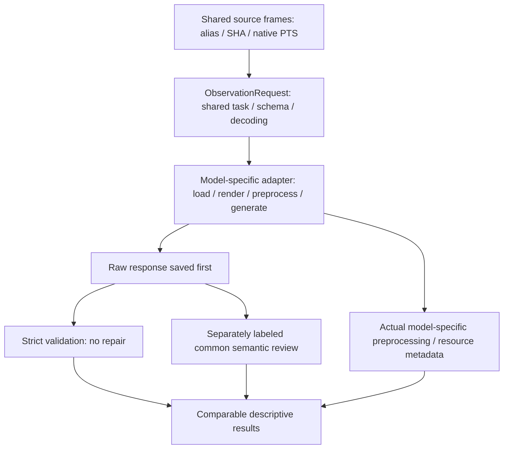

# Cross-model observation preparation

查核日：2026-10-17。**只準備介面與查官方metadata；沒有下載或執行新模型，沒有新模型實測VRAM／品質結果。**

## 最小介面

已新增 [observation_interface.py](C:/Users/smile/Desktop/test2/mixure_test_SAM/src/memory_graph/experiments/observation_interface.py)。`SourceFrame`保存path、alias、source index、native PTS、SHA；`ObservationRequest`另保存recorded video SHA、system/task、schema、generation及model/preprocessing設定。Source video SHA只是既有紀錄，API不會自行開啟原影片驗證。

`ObservationAdapter`明確分成load、render、preprocess、generate、resources、close；`AdapterValue.data`可為任何模型自己的輸入，metadata必須可JSON序列化。**沒有Qwen processor／chat-template／token-count假設。** `execute_once`預設禁止生成、先驗來源與順序、使用新目錄防重跑、要求preprocess的`consumed_aliases`與輸入一字不差且順序一致，之後才允許generate。原文先寫入並fsync，再跑外部validator；validator例外仍保留原文，絕不補成NO_EVENT。

Adapter必須在metadata記錄實際resize／crop／tiling、token數（可得時）、temporal units／alias mapping、rendered文字、effective generation與資源。Model-neutral wrapper只驗source consumption，不會把adapter自報metadata誤稱獨立驗證；模型特有token合併仍需個別核對。不同模型可使用不同token數，不能私自減少或替換source frames。相同圖片不表示相同內部時間表示或相同量化品質。

目前是**可呼叫的通用執行邊界＋CPU contract tests**；既有Qwen ablation沿用原NF4程式，沒有為了接介面重跑。尚未實作Nemotron／VideoLLaMA3的真實adapter。沒有自動模型選擇、下載、server、retry或排程。Caller的`allow_generation=True`只表達呼叫意圖，不能代替人類授權或跳過adapter自身安全門檻。

驗證：`PYTHONPATH=src .venv\Scripts\python.exe -X utf8 -B -m unittest discover -s tests -p test_observation_interface.py -v`，**4/4通過**。測試只用CPU byte fixtures與RecordingAdapter，沒有影像fixture、VLM或physical-event GT。

## 官方模型相容性

| 項目 | NVIDIA Nemotron Nano v2 VL | VideoLLaMA3-7B |
|---|---|---|
| 已驗證官方ID | `nvidia/NVIDIA-Nemotron-Nano-12B-v2-VL-BF16`；另有`nvidia/NVIDIA-Nemotron-Nano-12B-v2-VL-FP8` | `DAMO-NLP-SG/VideoLLaMA3-7B`，不是`-Image` checkpoint |
| 來源／license標示 | NVIDIA；NVIDIA Open Model License | Alibaba DAMO；model card標Apache-2.0。Repo另有服務research/non-commercial說明，不能只憑標籤推定所有用途已釐清 |
| 視覺輸入／處理 | BF16 card寫multi-image上限4張，另支援video／預抽影格、512px tiles。不能直接假定8張獨立image路徑可用 | 官方有image、multi-image、video範例；自訂processor、SigLIP-NaViT、frame sampling／token compression。不能直接套Qwen2.5-VL processor |
| 框架 | BF16範例使用trust_remote_code、Transformers4.53.x、Mamba／causal-conv1d／timm／open_clip；官方偏Linux及server GPUs | 官方custom Transformers code，常見示例4.46.3、FlashAttention2、BF16；與目前4.57.6環境需獨立驗證 |
| 量化 | 官方FP8存在；該card描述single-image、Linux/vLLM/H100。多圖／video能力不可從BF16直接外推。NF4在本機未驗證 | BF16官方範例已驗證可查。bnb4bit/NF4是待測工程選項，本次所查官方資料未確認可直接套用的4bit部署方案 |
| RTX5070Ti16GB | **BF16純GPU不可行**：按官方12.6B×2 bytes計算，僅權重約25.2GB十進位，已超過16GiB，非實測。FP8／更低位元是否可容納8幀及其kernel，在本機未驗證 | **有條件候選**：7B名稱包含額外vision元件，不能保證BF16加activation可在16GB內；量化與attention替代路徑需單獨實測 |
| 目前主要阻礙 | 8-frame vs4-image、Windows／Mamba依賴、記憶體與variant輸入能力，revision尚未pin | custom code審閱、FlashAttention／vision相容性、量化、避免processor重採樣丟失exact frames，revision尚未pin |

NVIDIA事實來源：[BF16官方model card](https://huggingface.co/nvidia/NVIDIA-Nemotron-Nano-12B-v2-VL-BF16)、[FP8官方model card](https://huggingface.co/nvidia/NVIDIA-Nemotron-Nano-12B-v2-VL-FP8)。Card含不同variant與範例命名差異，實際選定版本後仍須核對config／revision；以上不表示本機部署已成功。

VideoLLaMA3事實來源：[官方model card](https://huggingface.co/DAMO-NLP-SG/VideoLLaMA3-7B)、[官方repo與license說明](https://github.com/DAMO-NLP-SG/VideoLLaMA3)、[processor source](https://huggingface.co/DAMO-NLP-SG/VideoLLaMA3-7B/blob/main/processing_videollama3.py)、[config](https://huggingface.co/DAMO-NLP-SG/VideoLLaMA3-7B/blob/main/config.json)。該模型的語言骨幹來自Qwen2.5-7B；與Qwen baseline有親緣，不能稱為完全獨立的語言骨幹對照。

本機只查套件metadata：Windows／Python3.12.14、Torch2.10.0+cu128、Transformers4.57.6、bnb0.50.2；目前此Python搜尋路徑未安裝flash-attn、mamba-ssm、causal-conv1d、open-clip-torch、timm。**沒有安裝或降級任何套件。** 缺少官方示例依賴不代表所有替代實作都不可能，但不能宣稱drop-in可用。不要為新模型改壞現有Qwen環境。

## 下一個共同任務與所需授權

建議比較「同一組8個exact frames中的逐物件狀態＋支持alias＋不確定性」，事件hypotheses另列為optional，不把沒有事件等同沒有觀察。沿用共同七維rubric、raw-first及strict/qualitative分離。這是下一實驗的**任務建議**，不是已核准的新prompt或更多call。

先以`VideoLLaMA3-7B`作較小的候選相容性探索，仍以Qwen為baseline；Nemotron因輸入與環境限制列為後續候選。這是工程成本排序，不是品質排名。正式比較前必須由使用者授權確切模型ID／revision、權重下載、量化與隔離環境變更、共享prompt/schema／frame representation及call上限；目前沒有這些新模型執行授權。

之後仍需另外預註冊held-out比較，不能從test5/test7的漂亮結果選出「已證明較佳」方法。本次未讀取／執行Frozen split，未啟動新模型推論。
