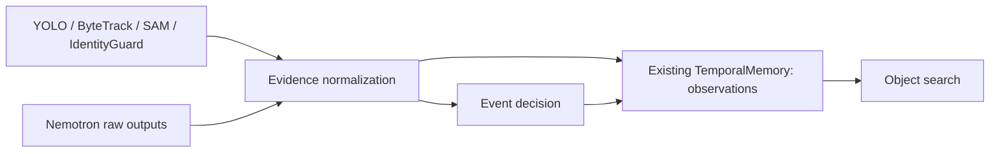

# Phase 4 recorded demo

| Video | CV / VLM observations | Supported / Rejected / Uncertain | Search |
|---|---|---|---|
| test1 | 675 / 197 | 0 / 3 / 8 | UNKNOWN |
| test2 | 858 / 94 | 0 / 4 / 12 | UNKNOWN |
| test3 | 973 / 171 | 0 / 9 / 13 | UNKNOWN |
| test4 | 936 / 155 | 0 / 7 / 15 | UNKNOWN |
| test5 | 921 / 182 | 0 / 2 / 8 | UNKNOWN |
| test6 | 710 / 180 | 0 / 5 / 3 | UNKNOWN |
| test7 | 1140 / 147 | 0 / 9 / 8 | UNKNOWN |
| test8 | 918 / 212 | 0 / 3 / 11 | UNKNOWN |
| test9 | 1032 / 185 | 0 / 11 / 12 | UNKNOWN |

Graph records and provenance are in each video directory. No VLM category is bound to a persistent entity. CV geometry alone supplies no named destination or independent held/surface transition.
