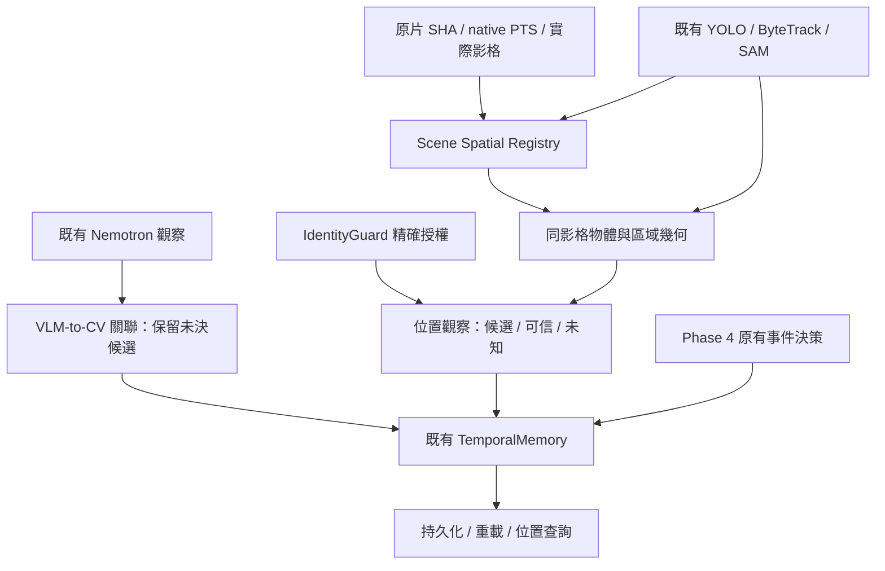

# Phase 5：物體空間記憶實作與九片執行報告

更新：2026-10-20。權威來源：`artifacts/phase5/PHASE5_SPATIAL_MEMORY_REPORT.md`。正式輸出：`artifacts/phase5/demo/`。

**已完成可查詢的「候選空間記憶」端到端實作與九片實跑；尚未得到可宣稱手機確實位於某處的可信位置。** 六片有具名區域候選，三片 UNKNOWN。所有候選都有來源影格、native PTS、物體與區域證據；不將影像重疊當成接觸、收納或 persistent identity。

## 真實結果

| 影片 | 區域候選 | 全類別候選關聯 | 手機候選位置觀察 | 手機查詢 |
|---|---:|---:|---:|---|
| test1 | 63 | 199 | 16 | POSSIBLE_LOCATIONS：table detected extent |
| test2 | 91 | 205 | 44 | POSSIBLE_LOCATIONS：table / microwave detected extent |
| test3 | 140 | 235 | 4 | POSSIBLE_LOCATIONS：table / microwave detected extent |
| test4 | 173 | 259 | 1 | POSSIBLE_LOCATIONS：table detected extent |
| test5 | 125 | 186 | 0 | UNKNOWN |
| test6 | 113 | 153 | 11 | POSSIBLE_LOCATIONS：microwave detected extent |
| test7 | 145 | 264 | 12 | POSSIBLE_LOCATIONS：microwave detected extent |
| test8 | 124 | 267 | 0 | UNKNOWN |
| test9 | 69 | 229 | 0 | UNKNOWN |
| 合計 | **1,043** | **1,997** | **88** | **6 有候選／3 UNKNOWN** |

- 1,043 筆為**逐影格區域觀察**，不是 1,043 個不同物理地點：992 個偵測框範圍、51 個原片邊緣四邊形。沒有跨視角合併實體區域。
- Verified regions：**0**；verified object-region associations：**0**；可信位置歷史：**0**。
- 全類別物體／區域關聯共 4,577 筆：1,997 CANDIDATE、2,580 UNKNOWN；VERIFIED／CONTRADICTED 都是 0。UNKNOWN 是距離、可見性或幾何不足，不是確認不在場。
- 手機共 88 筆候選、264 筆 UNKNOWN 幾何配對；88 筆中 **17 筆**有既有 IdentityGuard 的精確 CV 身分授權，但空間關係仍僅 CANDIDATE。這不是 17 個確認位置。
- 1,523 筆 VLM-to-CV 關聯全部 UNRESOLVED。手機 313 筆中，262 筆沒有同影格、同時間的相容 CV 候選；51 筆有候選但沒有物體定位座標。缺少相同採樣格的候選，不等於整段沒有偵測或目標不存在。
- Phase 4 事件維持 **0 SUPPORTED／53 REJECTED／90 UNCERTAIN**。沒有為增加結果數而放寬確認規則。
- 讀取九片原片，擷取 1,245 個證據影格。沿用 184 份 Nemotron 輸出與 8,163 筆 CV 觀察；新增模型推論 **0**。

區域數與候選數不是品質或正確率。某些 phone 候選是背景的其他電話裝置；此類結果只能回答「類別候選出現在哪些畫面區域」，不能直接回答「你的那支手機現在在哪裡」。

## 實作與資料流



新增 `regions.py`、`spatial.py`、`run_phase5_demo.py` 與測試。既有 `pipeline.search()` 只增加 Phase 5 metadata dispatch，Phase 4 原有決策與搜尋分支保留。

**區域：** 以既有 table、microwave 等偵測及原片像素提出候選。偵測框明確標示 detected extent；CPU Canny／凸四邊形提供 planar-looking patch candidate。四邊形可能是正面、紋理或背景，不能冒充微波爐頂面或桌面。所有自動區域語意和物理表面均未驗證。

**時間與鏡頭：** 每筆 geometry 僅對來源影格有效；不傳播舊座標、不依 tracker ID 或相似像素位置認定同一物理區域。相位相關只記錄視角／場景變動診斷，不授權 propagation。這次有 497 段取樣間隔被標示可能變動，並非 497 個已確認鏡頭運動事件。

**關聯：** 支援 INSIDE_REGION、OVERLAPS_REGION、NEAR_REGION、ABOVE_REGION、POSSIBLY_ON_SURFACE、ON_SURFACE、UNKNOWN。前四者目前是 image-space 關係；INSIDE_REGION 不表示放進盒子。使用凸多邊形交集與邊界距離；框／邊緣本身不提供物理接觸證據。ON_SURFACE 必須有精確綁定的獨立接觸證據與 verified usable surface。

**身分：** 同影格、source SHA、native PTS、類別只建立候選集合。只有明確來源像素座標與唯一幾何配對，才能解決 local observation association；持久身分另需原 IdentityGuard 授權。現有 Nemotron 不具這類座標，沒有強制綁定。

**記憶與搜尋：** 使用現有 TemporalMemory 的 metadata、entity evidence、graph_edges 儲存區域、位置、來源和歷史；沒有第二套 Graph。位置記錄不依賴 SUPPORTED 事件。可信歷史與候選分開，後來未驗證候選不覆蓋較早可信位置。查詢區分 LAST_CONFIRMED_LOCATION、POSSIBLE_LOCATIONS、UNKNOWN；有授權候選先於未解決身分候選，同級保留排序未決與時間顯示順序，不用固定加權公式。任何結果均不保證目前仍在原處。

## 已看過的原片代表證據

以下是本次開發者視覺檢查，不是新人工 GT，也沒有回灌 runtime 的自動結果。

| 情境 | 直接檢視的來源 | 觀察與限制 |
|---|---|---|
| 手機明顯出現在桌面上 | test1 f240；test2 f282 | 可見手機貼近桌面；程式僅有桌子偵測範圍，故維持投影候選，沒有把本次人工視覺印象寫成自動 ON_SURFACE。 |
| 手機被手持、投影落在桌子範圍 | test2 f102；test1 f360 | 2D 幾何與「在桌上」不同。f102 的手機框位於桌子框內，仍不升格 VERIFIED。 |
| 物體被籃球／手遮住 | test1 f360→420→468 | 先看到手持手機，後段手機不清楚、籃球佔據前景。不能推斷進入籃球、放置完成或確定去向。 |
| 鏡頭轉向 | test5 f552→621→690 | 桌子／盒子視角轉到房間與微波爐區；舊桌子座標不沿用到新視角。 |
| 可見手機但缺少相應 CV phone 框 | test2 f85；test1 f360 | 原片可見手中手機，該格沒有相應 phone detection；保留未解決，不能標為不存在。 |
| 有手機框但缺少同格桌子區域 | test8 f300、372 | 原片桌上手機清楚，CV phone 框存在，但該格沒有有效 table region；結果 UNKNOWN，不能把舊視角的桌框補過來。 |
| 類別干擾 | test2 f606、738；test1 f744 | 背景直立電話手持機也被框成 phone。更精確地說是其他電話裝置；早先口頭稱為遙控器不足以確定品類。不能自動當成目標 smartphone。 |

證據入口：
- [test1 原片概覽與手機／遮擋](C:/Users/smile/Desktop/test2/mixure_test_SAM/artifacts/phase5/demo/test1/evidence_01.jpg)
- [test1 區域與背景干擾](C:/Users/smile/Desktop/test2/mixure_test_SAM/artifacts/phase5/demo/test1/evidence_03.jpg)
- [test2 手持／桌面／缺漏偵測](C:/Users/smile/Desktop/test2/mixure_test_SAM/artifacts/phase5/demo/test2/evidence_03.jpg)
- [test5 鏡頭移動](C:/Users/smile/Desktop/test2/mixure_test_SAM/artifacts/phase5/demo/test5/evidence_02.jpg)
- [test8 可見手機但缺少桌面區域](C:/Users/smile/Desktop/test2/mixure_test_SAM/artifacts/phase5/demo/test8/evidence_03.jpg)

test5 與 test8 各有 12／40 個 phone-region 配對，但都未形成可用近鄰關係；test9 的 phone 觀察和 scene region 缺少同格配對。這是目前三個 UNKNOWN 的直接原因，沒有用已知故事或 GT 補位置。

## 使用方式

在專案根目錄查詢已儲存 Graph，不需重跑影片：

```powershell
.venv\Scripts\python.exe -X utf8 -B scripts/run_phase5_demo.py --memory artifacts/phase5/demo/test2/memory_graph.json --query "Where is my phone?" --limit 5
```

也可用 `--query "手機"`、`--query "cup"`，或用 `--entity-id` 指定 Graph 中完整的授權實體 ID。類別查詢不代表已識別使用者的物品。`--limit 0` 顯示全部候選；每筆保留 evidence refs、frame、native time、關係、身分範圍和不確定性。

重新執行九片時指定尚不存在的隔離輸出：

```powershell
.venv\Scripts\python.exe -X utf8 -B scripts/run_phase5_demo.py --output artifacts/phase5/replay
```

新影片使用 `--bundle`：JSON 內含 `source_manifest` 路徑、`phase4_graphs`（任意 video ID 到既有 Phase 4 Graph 路徑）、可選 `input_receipts`。manifest 必須有來源 SHA、影片路徑、尺寸、native timeline；Graph 必須提供相同 source SHA／frame／PTS 的觀察。不依賴 test1–test9 命名或已知事件時間。

可選 `--regions` 載入明確標示 REVIEWER_SUPPLIED_REGION 的區域資料；本次沒有使用。獨立接觸量測可經 `enrich_memory(..., cues=...)` 接入，必須引用物體、區域、影格、時間和證據。現有模型輸出不能冒充這種量測。

## 驗證與保存

- **44 項 CPU 測試通過**：Phase 4 22 項、Phase 5 22 項。涵蓋原生時間、跨格失效、重疊不代表支撐、near box 不代表 inside、缺偵測、類別不授權身分、候選不覆蓋可信位置、其他物品查詢、身分排序、持久化／重載及 later held 失效。
- 九片 Graph 均持久化、重載，查詢結果相同；原事件與 transitions 序列不變。
- 1,653 個輸入檔案 hash 驗證，另對 Phase 4 與 GT/consolidation 下 273 個檔案做前後保存檢查，變更 0。GT 只讀位元組做保存 hash，沒有讀取裁決內容供推理。
- [完整執行 receipt、來源 hashes、統計](C:/Users/smile/Desktop/test2/mixure_test_SAM/artifacts/phase5/demo/run_receipt.json)
- [測試紀錄](C:/Users/smile/Desktop/test2/mixure_test_SAM/artifacts/phase5/CPU_TEST_RESULTS.md)
- 無新模型推論、無 production Memory Graph 寫入，沒有 commit 或 push。

正式輸出結構：

```text
artifacts/phase5/
  PHASE5_SPATIAL_MEMORY_REPORT.md
  CPU_TEST_RESULTS.md
  demo/
    run_receipt.json
    evidence_manifest.json
    test1/ ... test9/
      scene_regions.json
      object_region_relationships.json
      vlm_cv_associations.json
      unresolved_associations.json
      grounded_location_observations.json
      viewpoint_diagnostics.json
      memory_graph.json
      search_result.json
      frames/ + evidence_*.jpg
```

## 尚缺能力與優先順序

1. **同格的可用表面與目標定位覆蓋。** 桌面在原片清楚可見時，現有 detector 仍可能沒有 table 框；邊緣四邊形也不等於支撐面。這直接造成 test5／8／9 UNKNOWN。需要真正 surface masks／區域量測，以及小手機定位，不是增加 Graph 欄位。
2. **目標實例分辨。** phone 類別包含其他電話；Nemotron 缺少 localizing coordinates，無法與 CV 精確綁定。現有 SAM 觀察可保留，但 unknown 類別／可見性不被擅自當成手機定位。
3. **獨立接觸／支撐證據。** 目前自動流程不具足夠獨立接觸量測，故 VERIFIED 仍為零；「手持於桌上方」與「放在桌上」仍是關鍵缺口。
4. **跨鏡頭區域身份與有效幾何傳播。** 本版用逐格重建保證不誤用座標；還沒有跨視角地圖、3D、世界座標或 persistent room-region identity。
5. **產品化評估。** 候選位置不能當正確尋物答案。本次只證實來源可追溯、流程可執行及保護規則通過，沒有位置 accuracy／recall 或生產環境保證。

目前可以查「這類物體在何時、與哪個畫面區域有何關係」，並查看原片證據；還不能可靠承諾「你的那支手機目前就在某個桌面上」。
